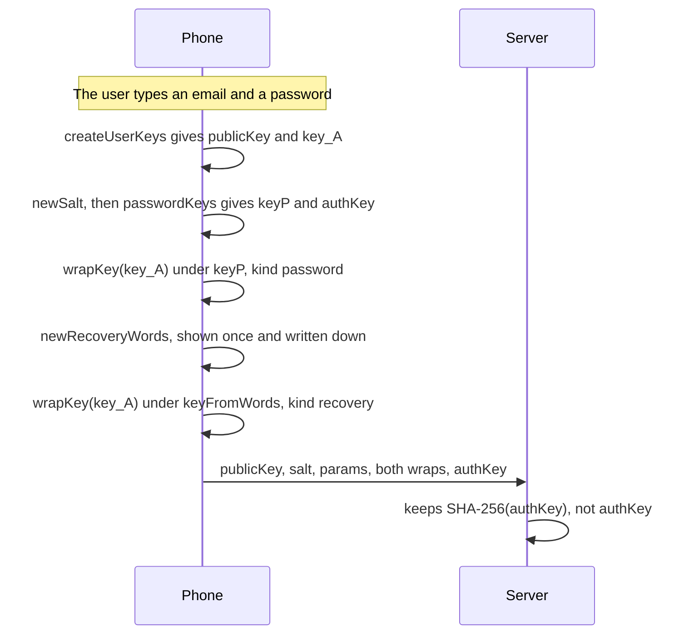

# 01 · Account setup

**Feature.** The user signs up with an email and a password, and writes down 12 recovery words shown once. Behind that, the phone makes the user's key pair, derives two keys from the password with Argon2id, and encrypts the private key (`key_A`) twice: under the password and under the words. The server receives the public key, the salt, the Argon2id parameters, both wraps and `authKey`, and keeps only a hash of `authKey`.

**Why.** Every other example depends on `key_A`. The server has to store it, so that the user gets it back on a new phone, without being able to read it. The password never leaves the phone: with it, the server could derive `keyP` and unwrap `key_A`.

## Flow



## Code

From [`index.ts`](index.ts):

```ts
const user = ez.createUserKeys(); // user.privateKey is key_A
const salt = ez.newSalt();
const { keyP, authKey } = ez.passwordKeys({ password, salt, params: DEFAULT_PASSWORD_PARAMS });
const passwordWrap = ez.wrapKey({ key: user.privateKey, wrappingKey: keyP, userId, kind: "password" });

const words = ez.newRecoveryWords(); // shown once, never sent or stored
const recoveryWrap = ez.wrapKey({ key: user.privateKey, wrappingKey: ez.keyFromWords(words), userId, kind: "recovery" });
```

| Function | Spec |
|---|---|
| `createUserKeys` | [Primitives](../../SPEC.md#primitives) |
| `newSalt`, `passwordKeys`, `DEFAULT_PASSWORD_PARAMS` | [Derived keys](../../SPEC.md#derived-keys) |
| `newRecoveryWords`, `keyFromWords` | [Derived keys](../../SPEC.md#derived-keys) |
| `wrapKey` | [Ciphertexts](../../SPEC.md#ciphertexts) |

## Pros

- The server holds everything needed to restore the account on a new phone, and none of it opens `key_A`.
- Two independent ways in: a forgotten password doesn't lose the data (see [03](../03-recover-with-words)).
- `keyP` and `authKey` are separate subkeys of one Argon2id run, so the `authKey` the server sees at sign-in doesn't give `keyP`.
- Each wrap is bound to the user id and its kind, so the server can't pass one user's wrap off as another's, or the recovery wrap as the password one.
- The server stores a hash of `authKey`, so a leaked database can't be replayed to sign in.

## Cons and limits

- **Offline guessing.** Whoever holds the salt, the parameters and the password wrap (the server, or anyone who breaches it) can try passwords offline. Argon2id makes each guess slow, not impossible: require long passwords.
- **Losing every way in loses the data.** If the user forgets the password, loses the words and has no unlocked device or passkey, nobody can open `key_A`, the server included. Ask the user to type back a few of the words before finishing sign-up.
- **Argon2id costs the phone time and memory:** 64 MiB and 3 passes by default. The parameters are stored with the salt, so they can be raised later by re-wrapping at the next sign-in.
- **The public key isn't authenticated.** An active server could hand other users a key of its own in place of this one ([SPEC.md, Limits](../../SPEC.md#limits)).
- **JavaScript can't wipe memory:** the password, the words and `key_A` stay in memory until garbage collection.

## Run it

```bash
pnpm build
node example/01-account-setup/index.ts
```
