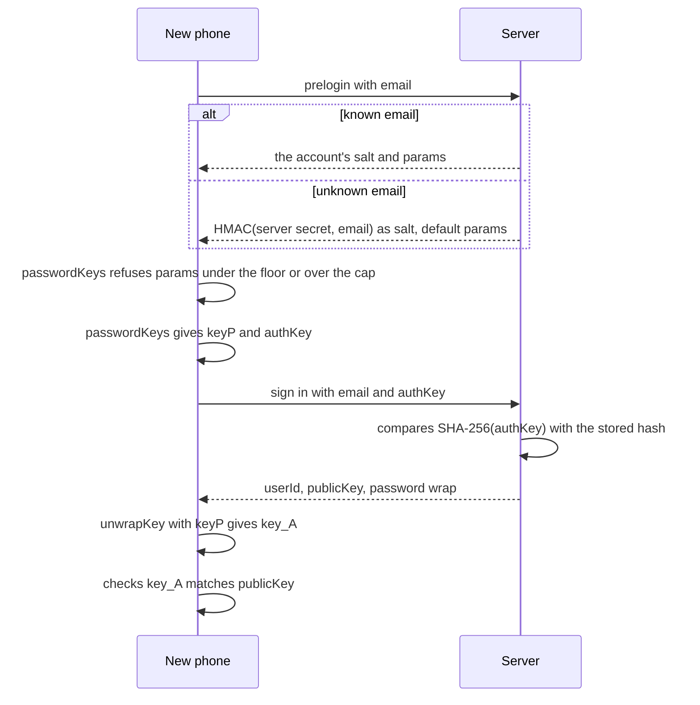

# 02 · Unlock with a password

**Feature.** On a new phone, the user types the email and password they signed up with and sees their data. Behind that, the phone asks the server for the account's salt and Argon2id parameters, runs `passwordKeys`, signs in with `authKey` and gets the password wrap back, which only `keyP` opens. It then checks that the unwrapped `key_A` belongs to the account's public key.

**Why.** The password has to unlock `key_A` on any device, but the server must not learn the password or anything that opens `key_A`. The server also shouldn't reveal who has an account, and shouldn't be able to make the phone derive weak keys.

## Flow



## Code

From [`index.ts`](index.ts):

```ts
const { salt, params } = preLogin(email); // server: a fake, stable salt for unknown emails
const { keyP, authKey } = ez.passwordKeys({ password, salt, params });
const account = signIn(email, authKey); // server: compares SHA-256(authKey)
const privateKey = ez.unwrapKey({ wrapped: account.passwordWrap, wrappingKey: keyP, userId: account.userId, kind: "password" });

// Only a matching pair opens what was sealed to the public key.
const sealed = ez.sealForUser({ value: new Uint8Array(), context: "key-check", publicKey: account.publicKey });
ez.openSealed({ sealed, context: "key-check", keyPair: { publicKey: account.publicKey, privateKey } });
```

| Function | Spec |
|---|---|
| `passwordKeys` | [Derived keys](../../SPEC.md#derived-keys) |
| `unwrapKey` | [Ciphertexts](../../SPEC.md#ciphertexts) |
| `sealForUser`, `openSealed` (for the key check) | [Ciphertexts](../../SPEC.md#ciphertexts) |

## Pros

- The password never leaves the phone. The server sees `authKey`, which can't be turned into `keyP`.
- An unknown email gets a salt that looks real and is the same on every request, so the prelogin answer doesn't reveal who signed up.
- The library refuses Argon2id parameters under the floor (`opsLimit` 2, 19 MiB) and over the cap (`opsLimit` 16, 256 MiB), so a server can't make `authKey` cheap to crack or crash the phone.
- The key check catches a wrap and a public key that don't belong together before the app uses them.

## Cons and limits

- **The fake salt only hides accounts from the prelogin answer.** Response times, sign-up ("email already taken") and password reset can still reveal them. The fake salt's key must stay secret and stable, or the same email gets different salts.
- **Offline guessing** of weak passwords stays possible for whoever holds the database (see [01](../01-account-setup)).
- **Rate-limit sign-in.** Each online guess costs the attacker one Argon2id run, which they can run on fast hardware.
- **An active server** can still serve a different public key to other users ([SPEC.md, Limits](../../SPEC.md#limits)). The key check here only proves the pair the server sent this phone belongs together.

## Run it

```bash
pnpm build
node example/02-unlock-with-password/index.ts
```
