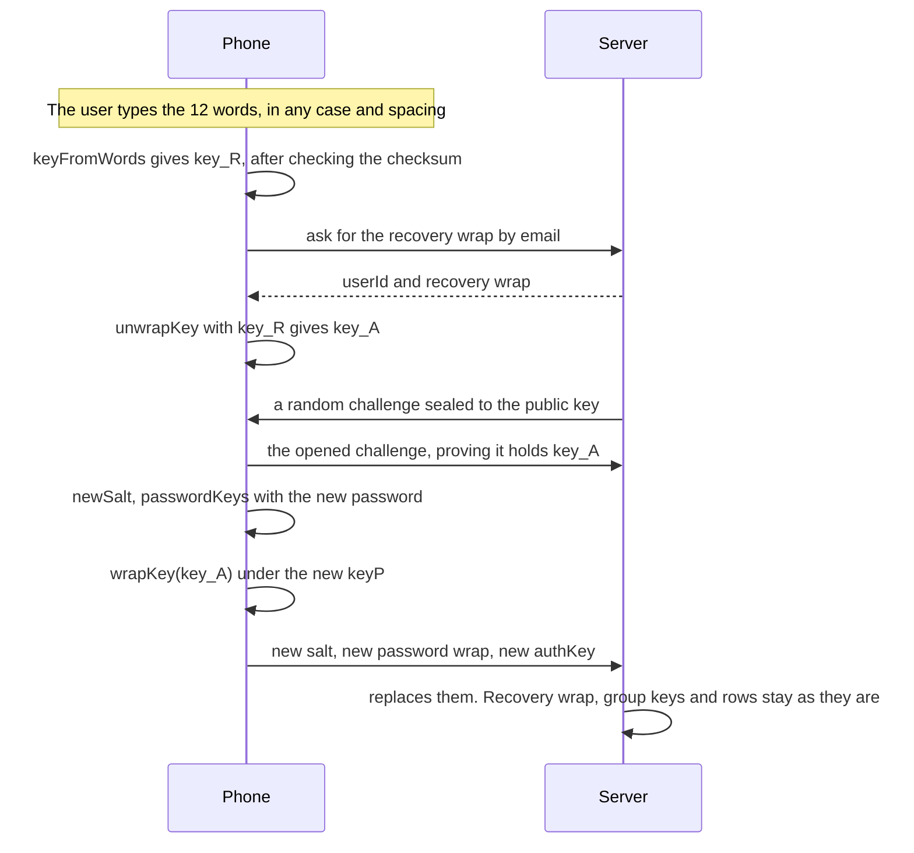

# 03 · Recover with the 12 words

**Feature.** A user who forgot their password types the 12 recovery words, chooses a new password and is back in, with all their data. Behind that, the phone derives `key_R` from the words, unwraps the `recovery` wrap to get `key_A`, proves to the server that it holds `key_A`, and uploads a new `password` wrap with a new salt and `authKey`. No group key and no row is re-encrypted.

**Why.** Passwords get forgotten. Without a second way in, a forgotten password would lose every group and row for good, since the server can't decrypt anything.

## Flow



## Code

From [`index.ts`](index.ts):

```ts
const keyR = ez.keyFromWords("  ABANDON   ability ... \n"); // trimmed, lowercased, single spaces
const privateKey = ez.unwrapKey({ wrapped: recoveryWrap, wrappingKey: keyR, userId, kind: "recovery" });

const salt = ez.newSalt();
const { keyP, authKey } = ez.passwordKeys({ password: newPassword, salt });
const passwordWrap = ez.wrapKey({ key: privateKey, wrappingKey: keyP, userId, kind: "password" });
```

| Function | Spec |
|---|---|
| `keyFromWords`, `newSalt`, `passwordKeys` | [Derived keys](../../SPEC.md#derived-keys) |
| `unwrapKey`, `wrapKey` | [Ciphertexts](../../SPEC.md#ciphertexts) |
| `sealForUser`, `openSealed` (for the challenge) | [Ciphertexts](../../SPEC.md#ciphertexts) |

## Pros

- Changing the password re-wraps one 32-byte key. Groups, rows and sealed values stay untouched, however much data the user has.
- The words carry 128 random bits, so the recovery wrap is safe to hand out by email: nobody can guess the words.
- Case and extra spaces don't matter, and the BIP-39 checksum catches most mistyped words before any decryption.
- The sealed challenge lets the server check the phone holds `key_A` without ever seeing it.

## Cons and limits

- **The words are as good as the password.** Whoever finds the paper gets `key_A`. Say so when showing them.
- **Lost words and a lost password lose the data**, unless another device or a passkey still unlocks it ([04](../04-passkey-prf), [05](../05-device-and-synced-copies)).
- **The challenge proves key possession, not identity.** Anyone holding the words can reset the password. In a real app, also require a code sent to the account's email, and notify the user.
- **Bad words only tell you the phrase is wrong,** not which word. Show your own message ("check each word and their order"), and keep what the user typed out of logs and crash reports.
- **The recovery wrap stays the same.** If the words may have leaked, make new words and a new `recovery` wrap after recovering, as at sign-up ([01](../01-account-setup)).

## Run it

```bash
pnpm build
node example/03-recover-with-words/index.ts
```
