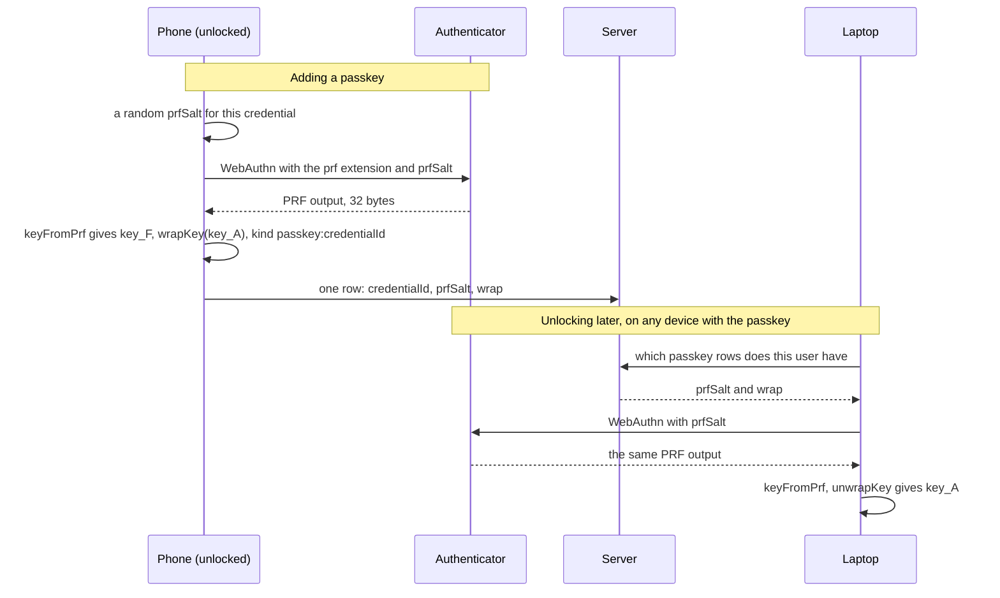

# 04 · Unlock with a passkey (PRF)

**Feature.** Optional: the user adds a passkey, and later unlocks with Face ID, Touch ID or a security key instead of typing the password. Behind that, the passkey's PRF extension gives 32 secret bytes that are the same every time for one credential and salt. `keyFromPrf` turns them into `key_F`, which wraps `key_A` under kind `passkey:<credentialId>`, one row per passkey.

**Why.** Typing a long password on every new device is tedious, and short passwords are guessable. A passkey's PRF output never leaves the authenticator unencrypted and can't be guessed, and passkeys sync across the user's devices on their own (iCloud Keychain, Google Password Manager).

## Flow



## Code

From [`index.ts`](index.ts). The PRF output is simulated as 32 random bytes per credential and salt. For real, it comes from:

- **Browsers:** `navigator.credentials.get({ publicKey: { …, extensions: { prf: { eval: { first: prfSalt } } } } })`, then `getClientExtensionResults().prf.results.first`.
- **iOS 18+ and Android 14+:** the same request through [`react-native-passkeys`](https://github.com/peterferguson/react-native-passkeys).

```ts
const keyF = ez.keyFromPrf(prfOutput);
const wrap = ez.wrapKey({ key: keyA, wrappingKey: keyF, userId, kind: `passkey:${credentialId}` });
// later, on any device with the passkey
const keyA = ez.unwrapKey({ wrapped: wrap, wrappingKey: ez.keyFromPrf(prfOutput), userId, kind: `passkey:${credentialId}` });
```

| Function | Spec |
|---|---|
| `keyFromPrf` | [Derived keys](../../SPEC.md#derived-keys) |
| `wrapKey`, `unwrapKey` | [Ciphertexts](../../SPEC.md#ciphertexts) |

## Pros

- Nothing to type, and nothing to guess: the PRF output is a 32-byte secret, not a password.
- One row per passkey. Adding or removing one never touches the password wrap, the recovery wrap or the other passkeys.
- The kind includes the credential id, so one passkey's wrap can't be passed off as another's.
- Passkeys sync through the platform, so a new phone on the same account often unlocks without the password.

## Cons and limits

- **Not every authenticator supports PRF.** Check `getClientExtensionResults().prf.enabled` when creating the passkey, and keep the password and words as the ways in that always work.
- **Unlocking isn't signing in.** The server still has to verify the WebAuthn assertion before handing out the rows. This example only shows the unlock.
- **Deleting the passkey from the password manager** loses that way in. Its row on the server is then useless, but harmless.
- **Whoever controls the synced passkey** (the platform account, its recovery) can unlock `key_A` through it.
- **An active server** can still serve a different public key to other users ([SPEC.md, Limits](../../SPEC.md#limits)).

## Run it

```bash
pnpm build
node example/04-passkey-prf/index.ts
```
