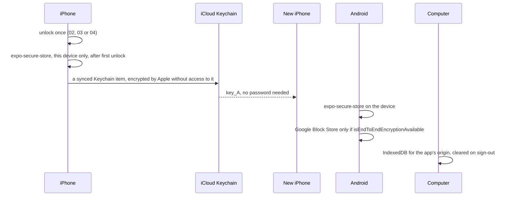

# 05 · Device and synced copies of `key_A`

**Feature.** After unlocking once, the user isn't asked for the password again on that device, and often not on their next phone either. Behind that, the app keeps `key_A` in the platform's secure storage, and, where the platform encrypts backups end to end, in a synced copy. **The library isn't involved here:** it made `key_A`, and keeping it is the platform's job. The example shows the decisions behind a small `KeyStore` interface with in-memory stand-ins.

**Why.** Argon2id takes time and the password is annoying to type. And the iOS notification extension and the Android notification service need `key_A` to open pushes ([10](../10-push-notifications)) while the app isn't running.

## Flow



## Code

From [`index.ts`](index.ts):

```ts
interface KeyStore {
	get(userId: string): Promise<Uint8Array | undefined>;
	set(userId: string, key: Uint8Array): Promise<void>;
	delete(userId: string): Promise<void>;
}
```

| Where | Real setting |
|---|---|
| iOS and Android, this device | [`expo-secure-store`](https://docs.expo.dev/versions/latest/sdk/securestore/) with `keychainAccessible: AFTER_FIRST_UNLOCK_THIS_DEVICE_ONLY`, readable while the phone is locked after its first unlock. On iOS, an `accessGroup` shared with the Notification Service Extension |
| iOS, synced | A second Keychain item with `kSecAttrSynchronizable` and `kSecAttrAccessibleAfterFirstUnlock`, through a small native module. iCloud Keychain is end-to-end encrypted |
| Android, synced | [Google Block Store](https://developers.google.com/identity/blockstore/android) with `setShouldBackupToCloud(true)`, only when `isEndToEndEncryptionAvailable()` is true. Otherwise skip it |
| Computer | IndexedDB for the app's origin, with a strict Content-Security-Policy, cleared on sign-out |

No library function is used beyond `createUserKeys` to make a key to store ([Primitives](../../SPEC.md#primitives)).

## Pros

- The password is needed once per device, or once per platform account with a synced copy.
- The notification extension can open pushes while the phone is locked.
- Each copy is protected by the platform: the iOS Keychain or the Android Keystore on the device, and the user's device passcode for the synced copies.

## Cons and limits

- **Every copy is another place `key_A` can leak from.** A synced copy is as safe as the user's Apple or Google account and its recovery.
- **Google Block Store without end-to-end encryption** would let Google read `key_A`. Check before storing, as the example does.
- **The browser copy is readable by any script on the page.** An XSS bug, a malicious extension, or a compromised script served by your own server can take it. The web app is only as trustworthy as the JavaScript the server sends.
- **"After first unlock" is a trade-off:** the key is readable while the phone is locked, so pushes can be opened. `WHEN_UNLOCKED` is stricter but breaks that.
- **No forward secrecy.** Whoever copies `key_A` once can open everything sealed to it, past and future ([SPEC.md, Limits](../../SPEC.md#limits)).

## Run it

```bash
pnpm build
node example/05-device-and-synced-copies/index.ts
```
