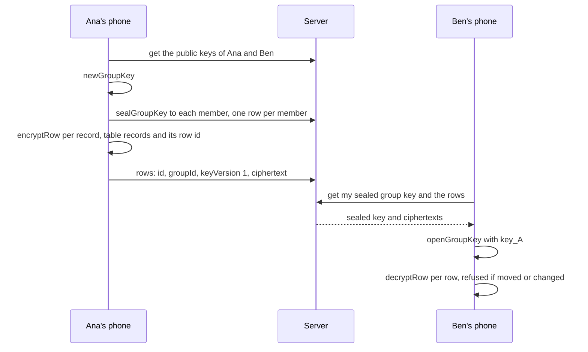

# 06 · Group rows

**Feature.** Users share a group (a team, a family, a project) and add shared records that every member sees, while the server stores only ciphertexts. Behind that, the creator's phone makes a random group key and seals it to each member's public key. Every row is encrypted with `encryptRow`, bound to its table and row id, so the server can't move or alter a row without the change being refused.

**Why.** Shared data needs one key that several people hold, and the server must be able to store, sync and order rows without reading them.

## Flow



## Code

From [`index.ts`](index.ts):

```ts
const groupKey = ez.newGroupKey();
const sealed = ez.sealGroupKey({ groupKey, groupId, publicKey: memberPublicKey }); // per member
const data = ez.encryptRow({ value: text(JSON.stringify(record)), groupKey, table: "records", rowId });

// on Ben's phone
const key = ez.openGroupKey({ sealed, groupId, keyPair: ben });
const record = JSON.parse(read(ez.decryptRow({ encrypted: data, groupKey: key, table: "records", rowId })));
```

| Function | Spec |
|---|---|
| `newGroupKey` | [Primitives](../../SPEC.md#primitives) |
| `sealGroupKey`, `openGroupKey` | [Ciphertexts](../../SPEC.md#ciphertexts) |
| `encryptRow`, `decryptRow` | [Ciphertexts](../../SPEC.md#ciphertexts) |

## Pros

- The server stores and syncs rows it can't read. A leaked database shows ciphertexts.
- A row is bound to its table and id: the server can't swap two rows, or pass a record off as another table's row. A changed byte is refused too.
- A sealed group key is bound to its group id.
- Adding a member is one more sealed copy of the key. Nothing is re-encrypted.

## Cons and limits

- **An active server can read group data.** Sealed boxes are anonymous and public keys aren't signed, so a server could hand out its own public key in place of a member's and receive the group key, or seal a key it knows ([SPEC.md, Limits](../../SPEC.md#limits)).
- **Metadata stays visible:** who is in which group, how many rows, their sizes and when they were written. Pad values if sizes matter.
- **The server can drop or replay a whole row.** Binding stops moving and editing, not deleting or restoring an old version of the same row.
- **The app records which key version encrypted each row** (`keyVersion` here). The library doesn't ([08](../08-member-removal)).
- **Server-side features that read values stop working:** search, totals, sorting by a field. They move to the phone.

## Run it

```bash
pnpm build
node example/06-group-rows/index.ts
```
