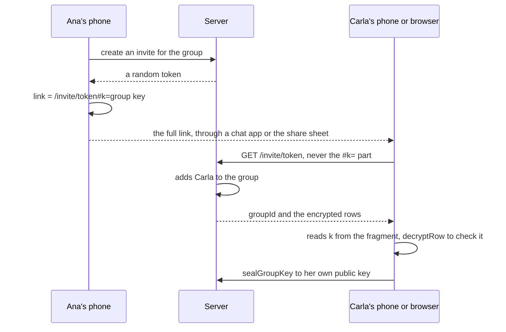

# 07 · Invite link

**Feature.** A member shares a link to the group. Whoever opens it joins and sees the expenses, without the creator having to approve each person. Behind that, the link is `https://app.example.com/invite/<token>#k=<group key>`. Browsers never send the part after `#` (the fragment) to the server, so the server sees the token, never the key. The joiner's app reads the key from the fragment, checks it opens the rows, and seals it to its own public key with `sealGroupKey`.

**Why.** Sealing the key to a new member needs their public key, so an existing member would have to be online after they join. A link carries the key itself and works at once.

## Flow



## Code

From [`index.ts`](index.ts):

```ts
const link = `https://app.example.com/invite/${token}#k=${toB64url(groupKey)}`;

// Carla's app
const url = new URL(link);
const groupKey = fromB64url(new URLSearchParams(url.hash.slice(1)).get("k") ?? "");
const { groupId, rows } = join(url.pathname, "carla"); // the server only ever sees this path
ez.decryptRow({ encrypted, groupKey, table: "expense", rowId }); // refused if the key was changed
const sealed = ez.sealGroupKey({ groupKey, groupId, publicKey: carla.publicKey });
```

The server's request log holds `GET /invite/<token>`, never the key.

| Function | Spec |
|---|---|
| `encryptRow`, `decryptRow` | [Ciphertexts](../../SPEC.md#ciphertexts) |
| `sealGroupKey` | [Ciphertexts](../../SPEC.md#ciphertexts) |

## Pros

- No member has to be online when someone joins.
- The server, its logs and its proxies see the token, never the key. Someone with only the token can join the group on the server but can't read it.
- The joiner checks the key opens the rows before keeping it, so a changed link is caught.

## Cons and limits

- **The link is the key.** Anyone who sees the full link (a chat app that isn't end-to-end encrypted, a screenshot, browser history and its sync) can read the group. Make tokens single-use or expiring, and rotate the key when it matters ([08](../08-member-removal)).
- **The web app reads the fragment with JavaScript the server serves.** A malicious or compromised server could ship a page that sends the fragment home. This holds for every web version of an end-to-end encrypted app.
- **Link previews:** chat apps fetch the URL to build a preview. They don't send the fragment, but they store the whole message.
- **An active server can read group data** in other ways ([SPEC.md, Limits](../../SPEC.md#limits)).

## Run it

```bash
pnpm build
node example/07-invite-link/index.ts
```
