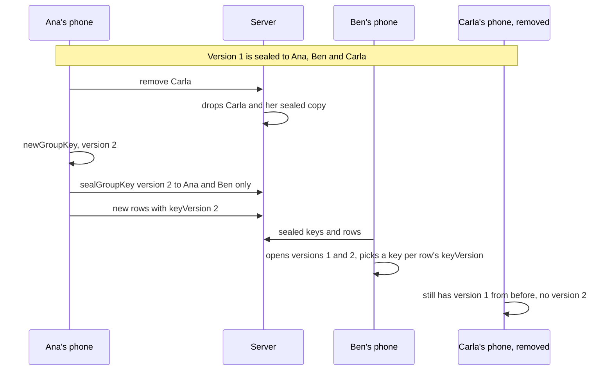

# 08 · Removing a member

**Feature.** A member leaves the group or is removed, and from then on can't read what the group adds. Behind that, a remaining member's phone makes a new group key (version 2) and seals it only to the members who stay. New rows use version 2. Old rows keep version 1, so nothing is re-encrypted. The removed member keeps version 1, which they already had, but never gets version 2.

**Why.** The server stops sending rows to a removed member, but that's access control on a server the app doesn't fully trust. A new key makes sure that even with the server's help, the removed member can't read new rows.

## Flow



## Code

From [`index.ts`](index.ts):

```ts
const v2 = ez.newGroupKey();
for (const userId of ["ana", "ben"]) {
	groupKeys.set(`${groupId}/2/${userId}`, ez.sealGroupKey({ groupKey: v2, groupId, publicKey: people[userId].publicKey }));
}
records.set(rowId, { keyVersion: 2, data: ez.encryptRow({ value, groupKey: v2, table: "records", rowId }) });

// any member: the key for a row is the one with the row's keyVersion
const groupKey = keys.get(row.keyVersion);
```

| Function | Spec |
|---|---|
| `newGroupKey` | [Primitives](../../SPEC.md#primitives) |
| `sealGroupKey`, `openGroupKey` | [Ciphertexts](../../SPEC.md#ciphertexts) |
| `encryptRow`, `decryptRow` | [Ciphertexts](../../SPEC.md#ciphertexts) |

## Pros

- Removing someone costs one new key and one sealed copy per remaining member. No row is re-encrypted.
- The removed member can't read new rows, even with the server's help, and can't open anyone else's sealed copy of version 2.
- The same steps work when a key may have leaked, for example through an invite link ([07](../07-invite-link)).

## Cons and limits

- **No taking back.** The removed member already had version 1 and every row they downloaded. Re-encrypting old rows with version 2 doesn't change that.
- **The app does the bookkeeping:** which version encrypted each row, and which versions each member holds. The library doesn't record it ([SPEC.md, Limits](../../SPEC.md#limits)).
- **The version isn't bound into the sealed key** (only the group id is). If the server mislabels versions, decryption fails rather than mixing keys, but the app should treat that as an error, not as missing data.
- **Someone has to be online** to make version 2. Until then, new rows would go out under version 1. Block writes until the new key exists.
- **An active server** could add its own public key as a member and receive version 2 ([SPEC.md, Limits](../../SPEC.md#limits)).

## Run it

```bash
pnpm build
node example/08-member-removal/index.ts
```
