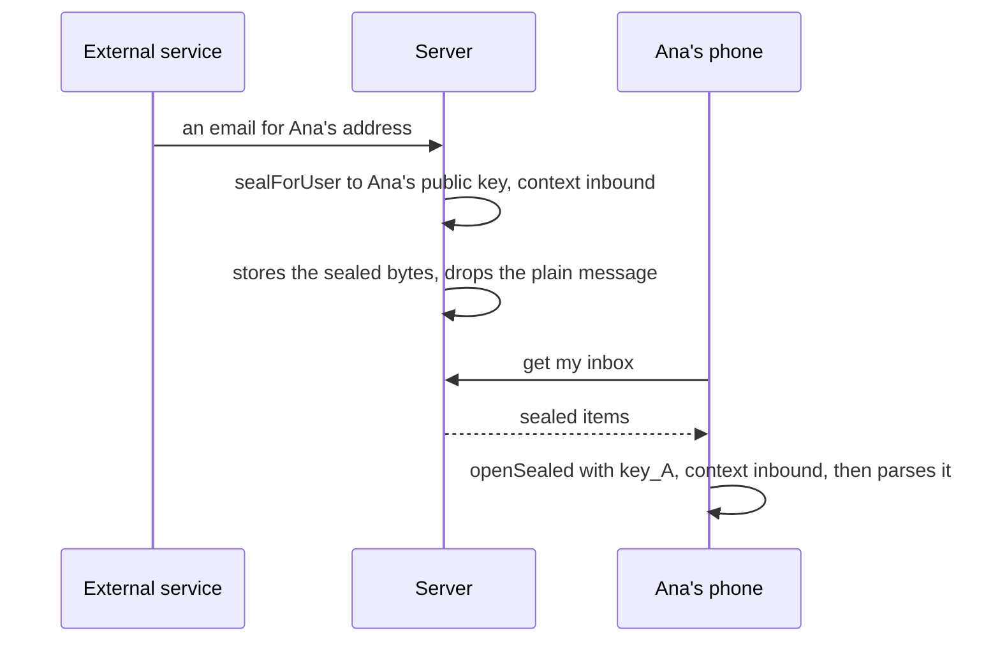

# 09 · Sealed ingest

**Feature.** Data from outside the app (an email, a webhook, an import) reaches a user, and it shows up in their app as their own data. Behind that, the server seals the whole message to the user's public key with `sealForUser` (context `inbound`) as it arrives, and keeps only the sealed bytes. Only the user's `key_A` opens it. End-to-end encrypted mail services encrypt incoming mail on arrival the same way.

**Why.** Some data reaches the app through the server first. Sealing it as soon as it arrives means the stored copy is unreadable to the server, to backups and to whoever breaches the database.

## Flow



## Code

From [`index.ts`](index.ts):

```ts
// server, on arrival: the raw message, as is
const sealed = ez.sealForUser({ value: text(raw), context: "inbound", publicKey });

// Ana's phone: open, then parse
const email = parseEmail(read(ez.openSealed({ sealed, context: "inbound", keyPair: ana })));
```

| Function | Spec |
|---|---|
| `sealForUser`, `openSealed` | [Ciphertexts](../../SPEC.md#ciphertexts) |

## Pros

- Anyone with the public key can seal, so the server can encrypt for a user who is offline, with no key of its own.
- The stored copy, its backups and replicas are unreadable without `key_A`.
- The context is bound: inbound data can't be passed off as a notification ([10](../10-push-notifications)) or anything else.

## Cons and limits

- **The server sees the data as it arrives.** Sealing protects what is stored, not the moment of ingest. Keep the handling in memory, and out of logs, queues and error reports.
- **Sealed boxes are anonymous.** The phone can't tell who sealed an item: anyone who can write to the inbox could add a fake one ([SPEC.md, Limits](../../SPEC.md#limits)). Treat inbound items as unverified until the user or a signature confirms them.
- **The server learns the metadata:** that something arrived for this user, when, from where, and its size.
- **No forward secrecy.** Whoever gets `key_A` later opens every item sealed to it ([SPEC.md, Limits](../../SPEC.md#limits)).

## Run it

```bash
pnpm build
node example/09-sealed-ingest/index.ts
```
