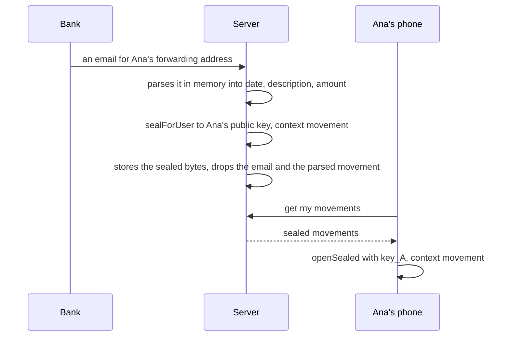

# 09 · Sealed ingest

**Feature.** The user forwards their bank's notification emails to the app, and the movements show up in the app ready to split. Behind that, the server parses each email in memory, seals the result to the user's public key with `sealForUser` (context `movement`), and keeps only the sealed bytes. Only the user's `key_A` opens it.

**Why.** Some data reaches the app through the server first: emails, webhooks, imports. Sealing it as soon as it arrives means the stored copy is unreadable to the server, to backups and to whoever breaches the database.

## Flow



## Code

From [`index.ts`](index.ts):

```ts
// server
const sealed = ez.sealForUser({ value: text(JSON.stringify(movement)), context: "movement", publicKey });

// Ana's phone
const movement = JSON.parse(read(ez.openSealed({ sealed, context: "movement", keyPair: ana })));
```

| Function | Spec |
|---|---|
| `sealForUser`, `openSealed` | [Ciphertexts](../../SPEC.md#ciphertexts) |

## Pros

- Anyone with the public key can seal, so the server can encrypt for a user who is offline, with no key of its own.
- The stored copy, its backups and replicas are unreadable without `key_A`.
- The context is bound: a sealed movement can't be passed off as a notification ([10](../10-push-notifications)) or anything else.

## Cons and limits

- **The server reads the email while parsing it.** Sealing protects what is stored, not the moment of ingest. Keep the parsing in memory, and out of logs, queues and error reports.
- **Sealed boxes are anonymous.** The phone can't tell who sealed a movement: anyone who can write to the inbox could add a fake one ([SPEC.md, Limits](../../SPEC.md#limits)). Show ingested items as suggestions for the user to confirm.
- **The server learns the metadata:** that a movement arrived for this user, when, and its size.
- **No forward secrecy.** Whoever gets `key_A` later opens every movement sealed to it ([SPEC.md, Limits](../../SPEC.md#limits)).

## Run it

```bash
pnpm build
node example/09-sealed-ingest/index.ts
```
