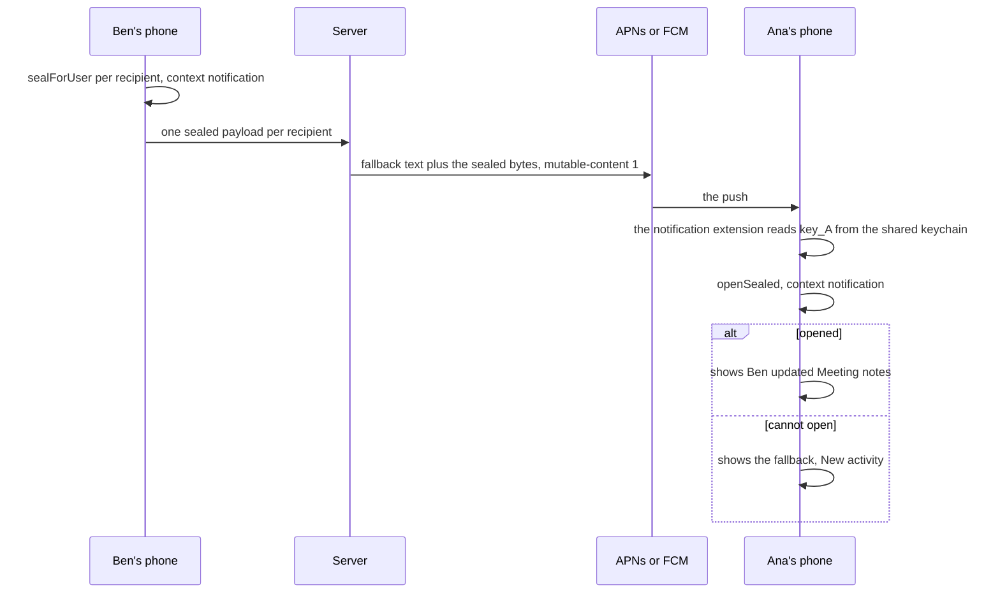

# 10 · Push notifications

**Feature.** When Ben updates a shared record, Ana and Carla get a push that reads "Ben updated Meeting notes", while the server, Apple and Google only ever see "New activity". Behind that, Ben's app seals the text once per recipient with `sealForUser` (context `notification`). The push carries a generic fallback text plus the sealed bytes. The recipient's phone opens them with `openSealed` before showing the notification.

**Why.** A notification's text is often the most sensitive part: who did what, and in which group. Without sealing, it would pass in the clear through the server, APNs and FCM.

## Flow



## Code

From [`index.ts`](index.ts):

```ts
// Ben's phone, per recipient
const sealed = ez.sealForUser({ value: text(JSON.stringify(message)), context: "notification", publicKey });
const payload = { aps: { alert: fallback, "mutable-content": 1 }, ezpriv: toB64url(sealed) };

// the recipient's phone
const message = JSON.parse(read(ez.openSealed({ sealed: fromB64url(payload.ezpriv), context: "notification", keyPair })));
```

The notification code can't run JavaScript, so it uses the ports, tested against the same vectors:

- **iOS:** a Notification Service Extension calling `openSealed` from [`ports/swift`](../../ports/swift), with `key_A` from a keychain access group shared with the app ([05](../05-device-and-synced-copies)).
- **Android:** a `FirebaseMessagingService` calling `openSealed` from [`ports/kotlin`](../../ports/kotlin), which isn't tested yet.

| Function | Spec |
|---|---|
| `sealForUser`, `openSealed` | [Ciphertexts](../../SPEC.md#ciphertexts) |

## Pros

- The text exists in the clear only on the sender's and the recipient's phones.
- The fallback text means a push still makes sense when it can't be opened (signed out, no key on this device yet).
- Sealing adds 84 bytes before base64 (version byte, 48 bytes of box, the context header), well under APNs' and FCM's 4 KB.
- The context is bound: sealed inbound data ([09](../09-sealed-ingest)) can't be shown as a notification.

## Cons and limits

- **Sealed boxes are anonymous.** The recipient can't tell who sealed a notification, so anyone with the public key could push a fake one ([SPEC.md, Limits](../../SPEC.md#limits)). Keep notifications informative only, and show the real data from the group's rows.
- **The sender seals once per recipient,** using public keys from the server. An active server can hand out its own key in place of a member's ([SPEC.md, Limits](../../SPEC.md#limits)).
- **Metadata is visible:** who notifies whom, when, and the payload size. Pad the text to a few fixed sizes if that matters.
- **iOS needs `mutable-content`** and a Notification Service Extension. Its key must be readable while the phone is locked, which is a trade-off ([05](../05-device-and-synced-copies)).

## Run it

```bash
pnpm build
node example/10-push-notifications/index.ts
```
