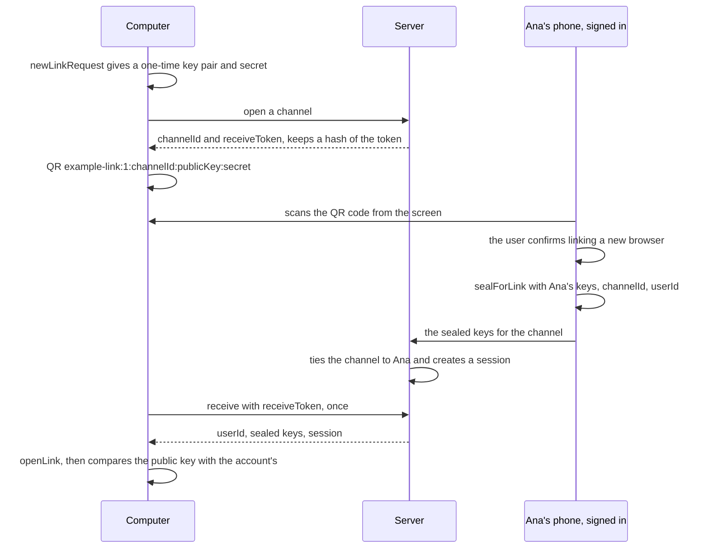

# 11 · Sign in on a computer by QR code

**Feature.** On the web version, the user scans a QR code with the phone, confirms, and the computer is signed in with all their data, without typing a password. Behind that, the computer makes a one-time key pair and secret (`newLinkRequest`) and opens a channel on the server, which returns a `channelId` and a `receiveToken`. The QR code shows the channel, the one-time public key and the secret. The phone seals the user's key pair for that computer (`sealForLink`), and the server ties the channel to the user and creates a session. The computer receives with its `receiveToken`, opens the keys (`openLink`) and checks the public key is the account's.

**Why.** Typing a long password on a shared or new computer is slow and exposes it to keyloggers. The phone already holds `key_A`, and the QR code is a channel from screen to camera that the server never sees.

## Flow



## Code

From [`index.ts`](index.ts):

```ts
// computer
const link = ez.newLinkRequest();
const qr = `example-link:1:${channelId}:${toB64url(link.publicKey)}:${toB64url(link.secret)}`;

// phone, after the user confirms
const { channelId, linkPublicKey, linkSecret } = parseQr(qr);
const sealed = ez.sealForLink({ userKeys: ana, channelId, userId: "ana", linkPublicKey, linkSecret });

// computer, after receiving with its receiveToken
const keys = ez.openLink({ sealed, channelId, userId, linkKeys: link });
assert.deepEqual(keys.publicKey, accountPublicKey);
```

The `example-link:` prefix is the app's own, so neither another app nor the system camera acts on the code. `receiveToken` is not in it.

| Function | Spec |
|---|---|
| `newLinkRequest`, `sealForLink`, `openLink` | [Ciphertexts](../../SPEC.md#ciphertexts) (Linked) |

## What the example shows failing

| Attacker | Has | Fails because |
|---|---|---|
| Knows only the computer's public key | `channelId`, public key, no secret | Their sealed keys don't decrypt under the real secret: `cannot decrypt` |
| A photo of the QR code | `channelId`, public key, secret | No `receiveToken`, so the server gives nothing. And the sealed keys open only with the computer's private key, which never left it: `cannot open` |
| A phone sending a private key of another pair | a mismatched key pair | `openLink` checks the pair: `linked keys don't match` |

## Pros

- No password typed on the computer. The server never sees the secret, and never sees `key_A`.
- Only someone who read the QR code can make a link the computer accepts, so a server can't push its own keys to the computer.
- A photo of the code can't receive the session or open the keys.
- The channel works once and the computer checks the public key, so a replayed or swapped link is caught.

## Cons and limits

- **Linking trusts whoever shows the QR code.** If an attacker gets the user to scan the attacker's code (a phishing page that shows its own QR), the attacker's computer gets `key_A` ([SPEC.md, Limits](../../SPEC.md#limits)). The phone must ask the user to confirm, with what the server saw of that browser (type, rough location), and the app's prefix keeps other apps from scanning it for you.
- **The QR code is secret until it's used.** A photo of it is enough to forge a link to that computer. Keep channels short-lived.
- **The browser then holds `key_A`,** with the risks of any web copy ([05](../05-device-and-synced-copies)): scripts on the page can read it. Offer "sign out of all browsers".
- **The whole key pair moves.** There's no per-device key to revoke. Removing a computer's access means signing it out; it keeps any key it copied.

## Run it

```bash
pnpm build
node example/11-qr-sign-in/index.ts
```
