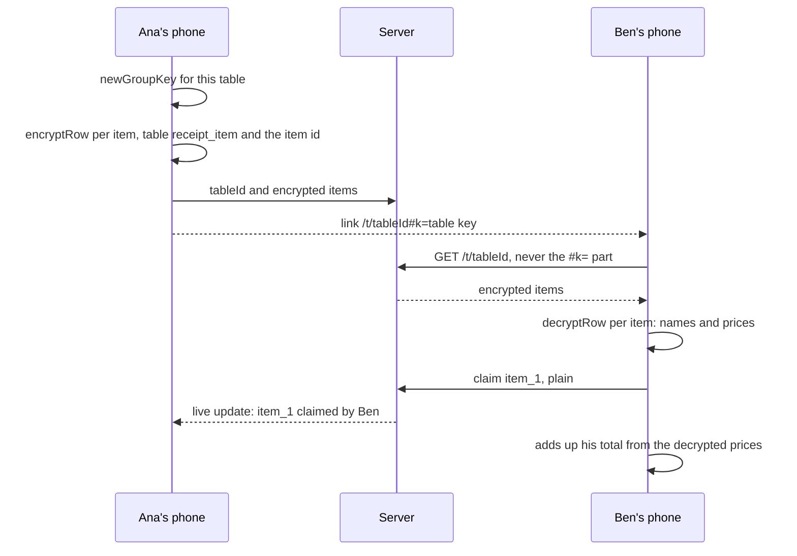

# 12 · Live receipt table by link

**Feature.** At a restaurant, one person scans the receipt and shares a link. Friends open it, tap the items they had, and everyone sees the claims appear live and their own total. Behind that, the receipt gets its own key, which travels in the link's fragment like an invite ([07](../07-invite-link)). Item names and prices are encrypted with `encryptRow` (table `receipt_item`). Claims (item id ↔ user id) stay plain, so claiming is an ordinary write with no cryptography.

**Why.** Splitting a bill needs to be instant and work for guests who just opened a link. Encrypting what was ordered and its price keeps the receipt private, and keeping claims plain keeps the live part simple and fast.

## Flow



## Code

From [`index.ts`](index.ts):

```ts
const tableKey = ez.newGroupKey();
const data = ez.encryptRow({ value: text(JSON.stringify(item)), groupKey: tableKey, table: "receipt_item", rowId: itemId });
const link = `https://app.example.com/t/${tableId}#k=${toB64url(tableKey)}`;

// claiming: no cryptography
claims.set("item_1", "ben");
```

| Function | Spec |
|---|---|
| `newGroupKey` | [Primitives](../../SPEC.md#primitives) |
| `encryptRow`, `decryptRow` | [Ciphertexts](../../SPEC.md#ciphertexts) |

## Pros

- Guests read the receipt with nothing but the link, and claiming is a plain realtime write.
- The server never sees what was ordered or what it cost.
- Items are bound to their ids: swapping two items' ciphertexts, to change who pays what, is refused.
- One key per receipt: a leaked link exposes one meal, not the group.

## Cons and limits

- **Claims are visible to the server:** who claimed how many items, and when. That's the price of claiming without cryptography.
- **Anyone with the link can claim,** and edit claims, unless the server requires a sign-in for writes. Read access is the key, write access is the server's.
- **The server can drop or replay claims,** and could show different claims to different people. Totals are as honest as the server.
- **The link is the key,** with the same exposure as an invite link ([07](../07-invite-link)), and the web page reading it is served by the server.

## Run it

```bash
pnpm build
node example/12-live-table-link/index.ts
```
