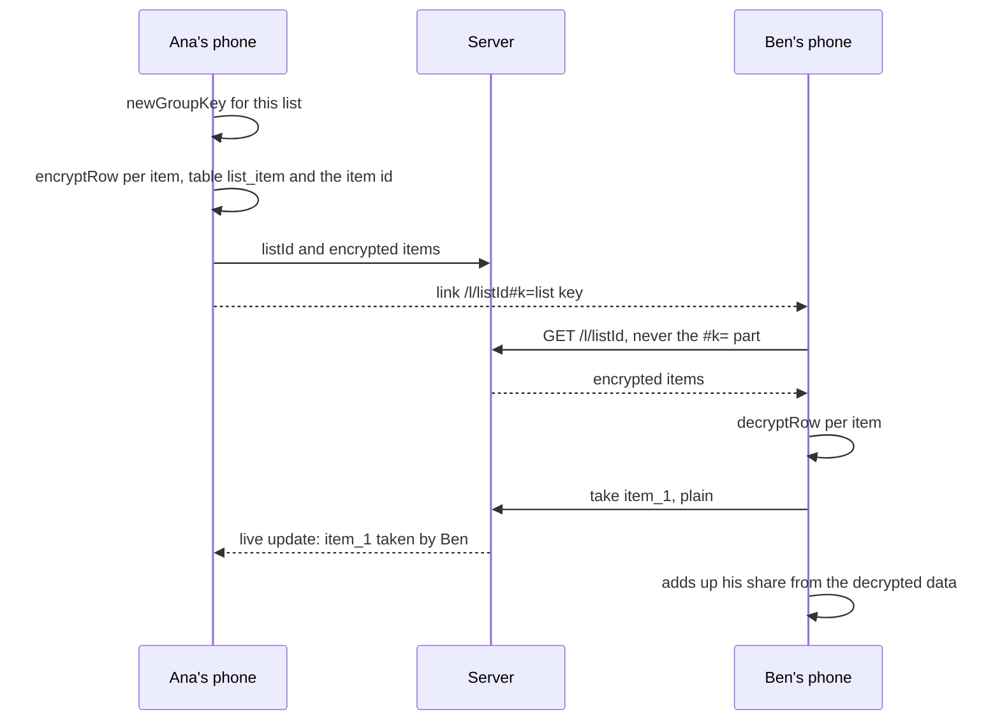

# 12 · Live list by link

**Feature.** One person shares a list by link (tasks, a sign-up sheet, anything with items). Whoever opens it sees the items, takes some, and everyone sees who took what, live. Behind that, the list gets its own key, which travels in the link's fragment like an invite ([07](../07-invite-link)). Item contents are encrypted with `encryptRow` (table `list_item`). Assignments (item id ↔ user id) stay plain, so taking an item is an ordinary write with no cryptography.

**Why.** Collaborative lists need to be instant and work for people who just opened a link. Encrypting the items keeps the content private, and keeping assignments plain keeps the live part simple and fast.

## Flow



## Code

From [`index.ts`](index.ts):

```ts
const listKey = ez.newGroupKey();
const data = ez.encryptRow({ value: text(JSON.stringify(item)), groupKey: listKey, table: "list_item", rowId: itemId });
const link = `https://app.example.com/l/${listId}#k=${toB64url(listKey)}`;

// taking an item: no cryptography
assignments.set("item_1", "ben");
```

| Function | Spec |
|---|---|
| `newGroupKey` | [Primitives](../../SPEC.md#primitives) |
| `encryptRow`, `decryptRow` | [Ciphertexts](../../SPEC.md#ciphertexts) |

## Pros

- Anyone with the link reads the list, and taking an item is a plain realtime write.
- The server never sees what the items say.
- Items are bound to their ids: swapping two items' ciphertexts, to change who does what, is refused.
- One key per list: a leaked link exposes one list, not the user's other data.

## Cons and limits

- **Assignments are visible to the server:** who took how many items, and when. That's the cost of assigning without cryptography.
- **Anyone with the link can take items,** and change assignments, unless the server requires a sign-in for writes. Read access is the key, write access is the server's.
- **The server can drop or replay assignments,** and could show different ones to different people. Totals are as honest as the server.
- **The link is the key,** with the same exposure as an invite link ([07](../07-invite-link)), and the web page reading it is served by the server.

## Run it

```bash
pnpm build
node example/12-live-table-link/index.ts
```
