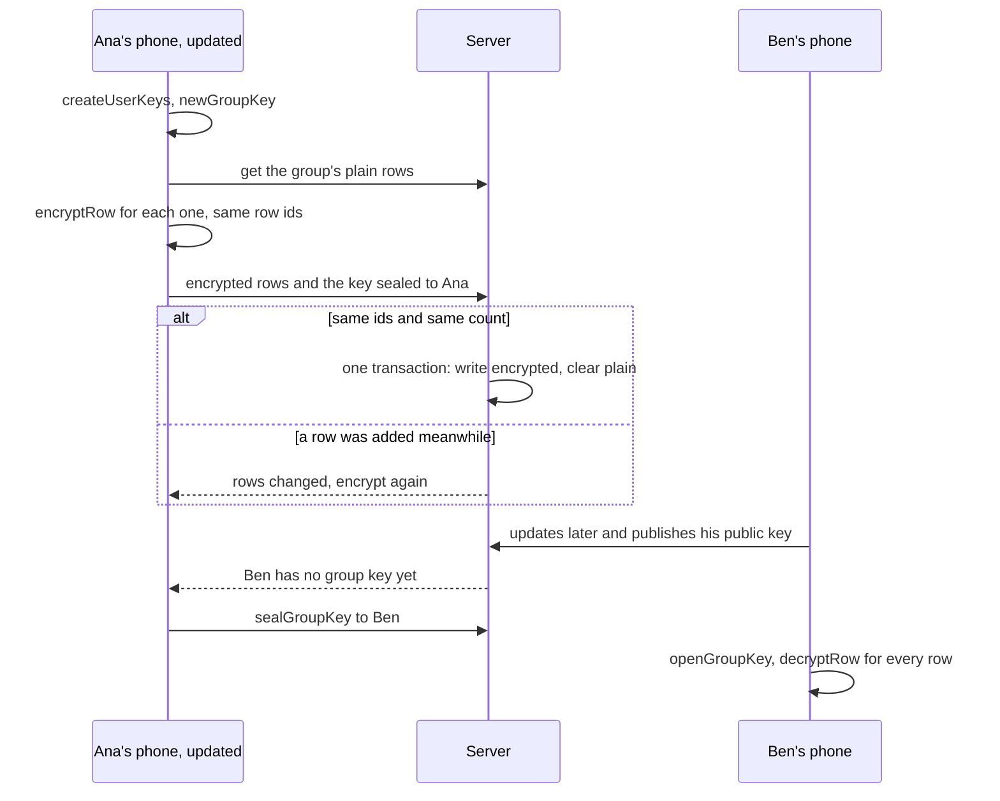

# 13 · Migrating existing plain rows

**Feature.** An app that already has groups with plain data ships end-to-end encryption, and existing groups switch over without losing a row. Behind that, the first member to update makes the group key, encrypts every plain row and uploads them all. The server checks that every plain row has an encrypted counterpart (same ids, same count) and only then writes them and clears the plain copies, all at once. Members who update later get their sealed copy of the key from another member's app, since the server can't make one.

**Why.** The server can't encrypt for the group: it must not hold the key. So a client has to do it, and the switch must never leave a group with some rows missing or half encrypted.

## Flow



## Code

From [`index.ts`](index.ts):

```ts
// Ana's app
const rows = new Map(plainRows.map(([rowId, fields]) =>
	[rowId, ez.encryptRow({ value: text(JSON.stringify(fields)), groupKey, table: "expense", rowId })]));

// server: refuse unless every plain row has an encrypted counterpart
if (ids.length !== rows.size || ids.some((id) => !rows.has(id))) throw new Error("rows changed, encrypt again");

// later, any member's app with the key
ez.sealGroupKey({ groupKey, groupId, publicKey: bensPublicKey });
```

| Function | Spec |
|---|---|
| `createUserKeys`, `newGroupKey` | [Primitives](../../SPEC.md#primitives) |
| `encryptRow`, `decryptRow` | [Ciphertexts](../../SPEC.md#ciphertexts) |
| `sealGroupKey`, `openGroupKey` | [Ciphertexts](../../SPEC.md#ciphertexts) |

## Pros

- No group is ever half migrated: either every row is encrypted, or nothing changed.
- A row added during the migration makes the upload fail instead of being lost. The app encrypts again.
- Members migrate at their own pace. Whoever updates later gets the key from any member who has it.
- Row ids stay the same, so links, claims and references keep working.

## Cons and limits

- **The server can't check the content.** It checks ids and counts, not that each ciphertext holds the right row. A buggy client could upload garbage, and once the plain copies are cleared, nobody can fix it. Have the app decrypt its own upload before sending it.
- **Old backups still hold the plain rows** until they expire. Say so to users, and shorten backup retention for those tables.
- **A member on an old app version** can't read the group after the switch. Ask them to update.
- **Until another member's app is online,** a member who updated later can't read the group.
- **An active server** could claim a fake member needs the key and receive it ([SPEC.md, Limits](../../SPEC.md#limits)). Show members who is getting the key.

## Run it

```bash
pnpm build
node example/13-migration/index.ts
```
